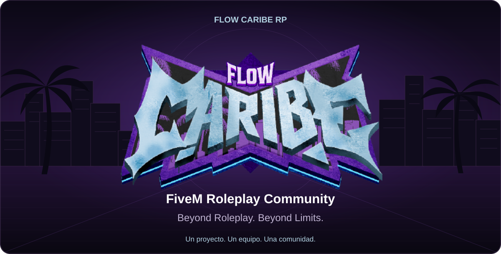
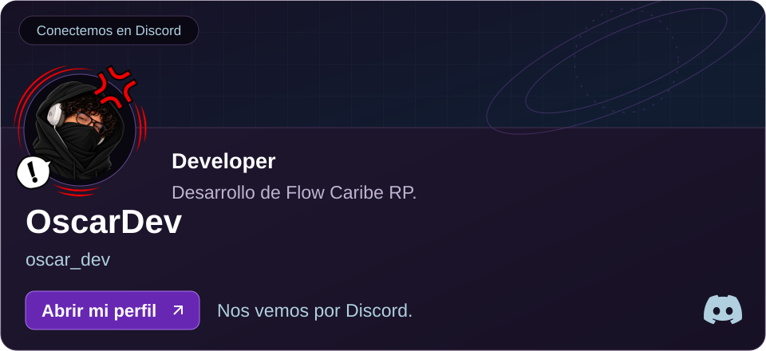
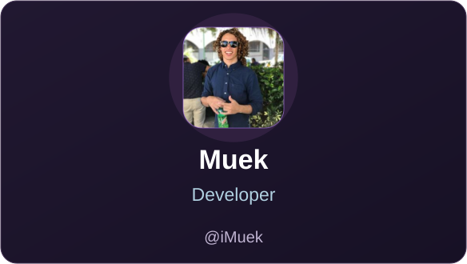
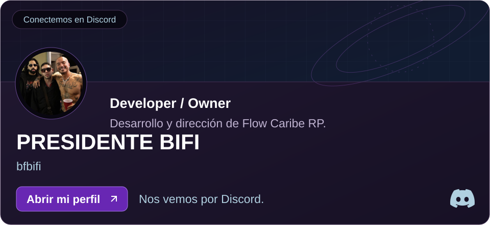
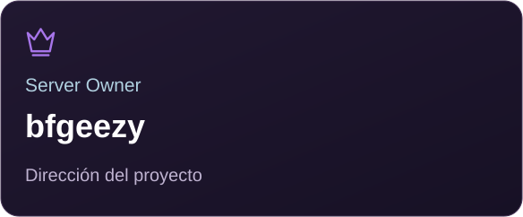
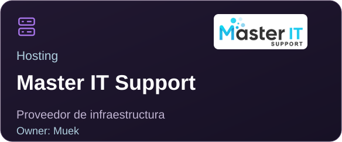
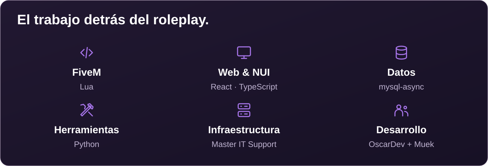
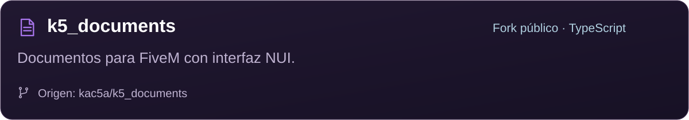
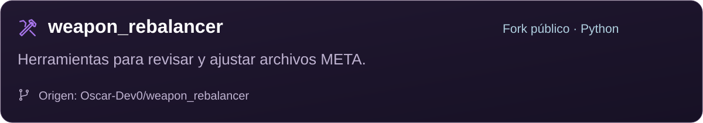

<!-- Generated by scripts/build_profile.py. Edit profile/profile.json or the builder. -->

  <a href="https://github.com/flowcariberp"><picture><source media="(max-width: 600px)" srcset="profile/assets/hero/mobile.svg" /></picture></a>

## ABOUT FLOW CARIBE RP

**Flow Caribe RP** es un proyecto de FiveM que reúne comunidad, desarrollo y operación técnica alrededor de una experiencia de roleplay con identidad caribeña. El trabajo en equipo sostiene la evolución del servidor, sus sistemas personalizados y las experiencias que comparte la comunidad.

## THE DEVELOPMENT TEAM

OscarDev, Muek y Bifi forman el equipo de desarrollo de Flow Caribe RP. Muek también es propietario de Master IT Support. Bifi combina desarrollo y dirección del servidor.

  <a href="https://discord.com/users/518251720128856084"><picture><source media="(max-width: 600px)" srcset="profile/assets/team/oscardev-mobile.svg" /></picture></a>
  <a href="https://discord.com/users/193858356052623360"><picture><source media="(max-width: 600px)" srcset="profile/assets/team/muek-mobile.svg" /></picture></a>
  <a href="https://discord.com/users/1234631585727254582"><picture><source media="(max-width: 600px)" srcset="profile/assets/team/bifi-mobile.svg" /></picture></a>

## PROJECT & INFRASTRUCTURE

  <a href="https://www.instagram.com/bfgeezy"><picture><source media="(max-width: 600px)" srcset="profile/assets/components/owner-mobile.svg" /></picture></a>
  <a href="https://masteritsupport.com/"><picture><source media="(max-width: 600px)" srcset="profile/assets/hosting/hosting-mobile.svg" /></picture></a>

## BEHIND THE EXPERIENCE

  <picture><source media="(max-width: 600px)" srcset="profile/assets/components/development-mobile.svg" /></picture>

Las tecnologías mostradas se pueden consultar en el código público de `flowcariberp`. Describen esos repositorios y no constituyen un inventario de lo que está desplegado en el servidor.

Consultar las referencias técnicas

| Área | Evidencia pública |
| :--- | :--- |
| FiveM, Lua y datos | [`fxmanifest.lua`](https://github.com/flowcariberp/k5_documents/blob/master/fxmanifest.lua): GTA V, Lua 5.4 y mysql-async. |
| Web & NUI | [`web/package.json`](https://github.com/flowcariberp/k5_documents/blob/master/web/package.json): React y TypeScript; interfaz NUI declarada en el manifiesto. |
| Herramientas | [`weapon_rebalancer`](https://github.com/flowcariberp/weapon_rebalancer): utilidades para archivos META; Python es el lenguaje predominante. |

## PUBLIC CODE

Una selección del código disponible en [GitHub de Flow Caribe RP](https://github.com/flowcariberp). Estos repositorios son **forks**; cada tarjeta reconoce su proyecto de origen.

  <a href="https://github.com/flowcariberp/k5_documents"><picture><source media="(max-width: 600px)" srcset="profile/assets/components/project-documents-mobile.svg" /></picture></a>

  <a href="https://github.com/flowcariberp/weapon_rebalancer"><picture><source media="(max-width: 600px)" srcset="profile/assets/components/project-weapons-mobile.svg" /></picture></a>

## OUR ECOSYSTEM

| Espacio | Enlace |
| :--- | :--- |
| **Flow Caribe RP** | [GitHub · flowcariberp](https://github.com/flowcariberp) |
| Organización de GitHub | [FlowCaribe](https://github.com/FlowCaribe) |
| OscarDev · Developer | [Discord · @oscar_dev](https://discord.com/users/518251720128856084) · [GitHub](https://github.com/Oscar-Dev0) |
| Muek · Developer · Owner de Master IT Support | [Discord · @muek](https://discord.com/users/193858356052623360) · [GitHub](https://github.com/iMuek) |
| Bifi · Developer / Owner | [Discord · @bfbifi](https://discord.com/users/1234631585727254582) |
| Bifi · Dirección del proyecto | [Instagram · bfgeezy](https://www.instagram.com/bfgeezy) |
| Master IT Support · Hosting · Owner: Muek | [Sitio oficial](https://masteritsupport.com/) |

  <picture><source media="(max-width: 600px)" srcset="profile/assets/components/footer-mobile.svg" /></picture>

<!-- Branding, sources and deployment: profile/docs/maintenance.md -->
